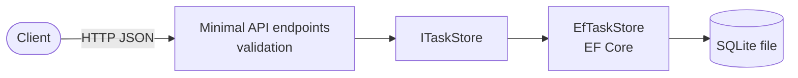

# Task Tracker API

[](https://github.com/Gurmeta/task-tracker-api/actions/workflows/ci.yml)
[](https://github.com/Gurmeta/task-tracker-api/releases/latest)
[](LICENSE)
[](https://dotnet.microsoft.com/download)

A small REST API for managing tasks, built with C# and .NET 10 (ASP.NET Core Minimal API).
It is a portfolio project that shows a complete delivery pipeline around a simple service:
tests, a hardened container image, CI/CD, versioned releases and published API documentation.

**Live project page:** <https://gurmeta.github.io/task-tracker-api/>

## Highlights

- Full CRUD with request validation and correct HTTP status codes
- EF Core with SQLite and versioned migrations applied at startup
- Integration tests that run against the real API with a temporary database per test
- Multi-stage Docker image: non-root user, health endpoint, data in a volume
- GitHub Actions: build, test, migration check, vulnerable-package check, image smoke test
- Tag-driven releases: versioned image on GHCR and a GitHub Release with generated notes
- Least-privilege workflows, with every third-party action pinned to a commit SHA

## Architecture



Endpoints depend on the `ITaskStore` interface, so the storage can be replaced without touching them.

## Quick start

### Docker

```bash
docker run --rm -p 8080:8080 -v task-tracker-data:/data ghcr.io/gurmeta/task-tracker-api:latest
```

Pin a specific version in real use, for example `ghcr.io/gurmeta/task-tracker-api:1.0.0`.

### From source

Requires the [.NET 10 SDK](https://dotnet.microsoft.com/download).

```bash
dotnet run --project src/TaskTracker.Api
```

With `dotnet run` the API listens on `http://localhost:5074` (the examples below use port 8080, the Docker port). In Development the OpenAPI document is served at `/openapi/v1.json`.
Sample requests are in `src/TaskTracker.Api/TaskTracker.Api.http` (REST Client extension for VS Code).

### Try it

```bash
# Check that the service is up and which version is running
curl http://localhost:8080/health
curl http://localhost:8080/version

# Create a task
curl -X POST http://localhost:8080/tasks \
  -H "Content-Type: application/json" \
  -d '{"title": "Write the docs", "dueDate": "2026-12-01T00:00:00Z"}'

# List tasks, optionally filtered by status
curl "http://localhost:8080/tasks?status=Todo"
```

Example response of the create call (`201 Created`):

```json
{
  "id": 1,
  "title": "Write the docs",
  "description": null,
  "status": "Todo",
  "createdAt": "2026-10-19T13:00:00Z",
  "dueDate": "2026-12-01T00:00:00Z"
}
```

Invalid input returns `400` with a validation problem document that lists the errors per field.
Status values are words (`Todo`, `InProgress`, `Done`), not numbers.

## API

| Method | Path          | Success                   | Errors   | Description             |
| ------ | ------------- | ------------------------- | -------- | ----------------------- |
| GET    | `/health`     | 200                       |          | Liveness probe          |
| GET    | `/version`    | 200                       |          | Running service version |
| GET    | `/tasks`      | 200 (optional `?status=`) | 400      | List tasks              |
| GET    | `/tasks/{id}` | 200                       | 404      | Get one task            |
| POST   | `/tasks`      | 201 + `Location`          | 400      | Create a task           |
| PUT    | `/tasks/{id}` | 200                       | 400, 404 | Replace a task          |
| DELETE | `/tasks/{id}` | 204                       | 404      | Delete a task           |

Constraints: `title` is required (max 100 characters), `description` is optional (max 500).

## Configuration

| Setting                      | Default                      | Purpose                       |
| ---------------------------- | ---------------------------- | ----------------------------- |
| `ConnectionStrings__Default` | `Data Source=tasktracker.db` | Location of the SQLite file   |
| `ASPNETCORE_HTTP_PORTS`      | `8080` in the container      | Port the service listens on   |
| `ASPNETCORE_ENVIRONMENT`     | `Production`                 | `Development` exposes OpenAPI |

The schema is created and updated automatically at startup through EF Core migrations.
In the container the database lives in `/data`; mount a volume there to keep your data.

```bash
ConnectionStrings__Default="Data Source=/tmp/tasks.db" dotnet run --project src/TaskTracker.Api
```

## Testing

```bash
dotnet test
```

The tests are xUnit v2 integration tests built on `WebApplicationFactory`. Each test starts the real API
with its own temporary SQLite file, so tests never share data. There are also unit tests for validation
and the data layer.

## CI/CD

Three workflows live in [`.github/workflows`](.github/workflows):

- `ci.yml` runs on pull requests and pushes to `main`. It builds, runs the tests, checks that migrations
  match the model, fails on vulnerable packages, and builds and smoke-tests the image.
  Pushes to `main` publish the `edge` and `sha-*` image tags (development builds).
- `release.yml` runs on `v*` tags. It checks the tag against the project version, runs the tests,
  publishes the versioned image and creates the GitHub Release.
- `pages.yml` runs on pushes to `main`. It exports the OpenAPI document and deploys the project page to GitHub Pages.

Pull requests never publish anything. Images are pushed with the built-in `GITHUB_TOKEN`; no personal tokens are used.

## Releases

The project follows [Semantic Versioning](https://semver.org/). The version lives in one place,
`<Version>` in `src/TaskTracker.Api/TaskTracker.Api.csproj`, and is reported by `GET /version`
and by the OpenAPI document.

Pushing a tag such as `v1.0.0` publishes these image tags:

| Tag      | Meaning                                     |
| -------- | ------------------------------------------- |
| `1.0.0`  | Exact release (use this in production)      |
| `1.0`    | Latest patch of the 1.0 line                |
| `latest` | Latest stable release                       |
| `edge`   | Latest build of `main` (not for production) |

Pre-release tags such as `v1.0.0-rc.1` publish only their own tag. See the [CHANGELOG](CHANGELOG.md)
and the [Releases page](https://github.com/Gurmeta/task-tracker-api/releases).

## Security

- The container runs as a non-root user, and CI fails if that changes.
- CI fails on NuGet packages with known vulnerabilities; Dependabot proposes updates weekly.
- Workflows use minimal permissions and actions pinned to commit SHAs.
- No secrets are stored in the repository; configuration comes from environment variables.

To report a vulnerability, see [SECURITY.md](SECURITY.md).

## Contributing

Contributions are welcome. Please read [CONTRIBUTING.md](CONTRIBUTING.md) first.

## Project layout

```text
src/TaskTracker.Api/      Web API
tests/TaskTracker.Tests/  xUnit tests
site/                     GitHub Pages project page
docs/                     Learning notes (Bulgarian)
.github/                  Workflows, Dependabot, PR template
```

## License

[MIT](LICENSE)
